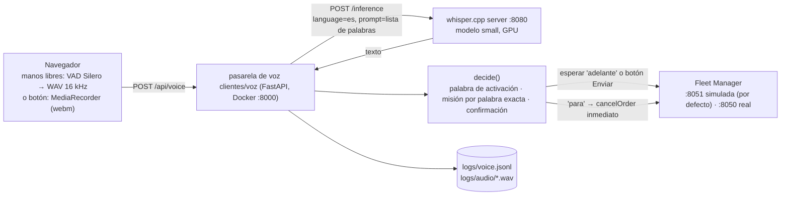

# Propuesta de detección de comandos de voz (estado a 27-10-2026)

Cómo funciona hoy el reconocimiento de órdenes por voz para la flota MiR250, por qué está
configurado así y cómo reproducirlo desde cero. Hay dos partes:

1. **Sistema desplegado** (pasarela de voz `clientes/voz` + whisper.cpp): es lo que está en marcha.
2. **Trabajo experimental** (decisor con LLM en `clientes/voz/app/interprete.py` y benchmarks en `clientes/voz/eval/`): medido, pero **sin desplegar**.

Los modelos (whisper.cpp, vLLM) se provisionan y sirven desde el repo `inferencia`.

---

## 1. Sistema desplegado

### 1.1 Flujo



Máquina de estados de la página (manos libres):

```
escuchando ─"tonto"→ ARMADO (8 s) ─orden→ confirmar (10 s) ─"adelante"→ enviar
escuchando ─"tonto, coge la caja"→ confirmar (10 s) ─"adelante"→ enviar
"tonto, para" → cancela la última orden al momento (sin confirmación)
sin palabra de activación → se ignora · orden desconocida → "no entendido"
```

### 1.2 Componentes y versiones

| Pieza | Versión / ajuste | Dónde |
|---|---|---|
| GPU | RTX 4050 Laptop, 6 GB, WSL2 | — |
| whisper.cpp | commit `da54572` (2026-09-15), CUDA, `sm_89` | `inferencia/servicios/whisper/` (scripts) |
| Modelo Whisper | `ggml-small.bin`, idioma `es` | descargado por `inferencia/servicios/whisper/compilar.sh` |
| VAD navegador | `@ricky0123/vad-web@0.0.31` + `onnxruntime-web@1.22.0` (jsdelivr) | `clientes/voz/app/static/index.html` |
| Pasarela de voz | FastAPI en Docker, puerto 8000 | `clientes/voz/` |
| Tabla de misiones | `missions.json` (se relee en cada petición) | `clientes/voz/missions.json` |

### 1.3 Servidor Whisper

Compilar (una vez; es lo que hace `inferencia/servicios/whisper/compilar.sh`):

```bash
sudo apt install -y build-essential cmake nvidia-cuda-toolkit ffmpeg git curl
git clone https://github.com/ggml-org/whisper.cpp.git && cd whisper.cpp
git checkout da54572
cmake -B build -DGGML_CUDA=ON -DCMAKE_CUDA_ARCHITECTURES=89   # sm_89 = RTX 4050
cmake --build build -j --config Release
./models/download-ggml-model.sh small
```

Arrancar (exactamente como corre ahora; `inferencia/servicios/whisper/arrancar.sh`):

```bash
build/bin/whisper-server -m models/ggml-small.bin -l es -t 4 -dev 0 \
  --host 0.0.0.0 --port 8080 -fa --convert
```

`--convert` (usa ffmpeg) permite recibir webm/ogg/mp3 del navegador directamente.

### 1.4 Petición a Whisper

`app/whisper_client.py` envía en cada frase:

| Campo | Valor |
|---|---|
| `language` | `es` |
| `temperature` | `0.0` |
| `response_format` | `json` |
| `prompt` | valor de `WHISPER_PROMPT` (abajo) |
| beam search | **no** (greedy, el valor por defecto del servidor) |

**Prompt actual** (`.env` de la pasarela):

```
WHISPER_PROMPT=tonto, deja, dejar, dejalo, dejala, trae, traelo, traer, coge, coger, cogela, cogelo, para, parar, paralo, stop, caja, pieza, diferencial, rueda, motor, tornillo, estantería, mesa, almacén, zona de carga, banco de trabajo.
```

Es la palabra de activación, todas las palabras de `missions.json` y los objetos y zonas.

> ⚠️ Los objetos y zonas (caja, pieza, rueda, estantería…) son **provisionales**: los inventé para
> el benchmark. En la sesión real del 27-10 se usaron *cosa, latas, cámaras, diferenciales, cajón,
> mesa, silla*. Hay que sustituirlos por el vocabulario real cuando se sepa.

Reglas que salieron de las pruebas (sección 3):

- **Lista de palabras sueltas, no frases.** Con frases de ejemplo, Whisper copió trozos del prompt en
  la transcripción ("deshaz la caja" → "deja la caja **en la estantería**").
- **Sin beam search.** `beam_size=5` no mejoró el acierto, añadió unos 240 ms y con ruido se inventó un "deja".
- **"adelante" NO va en el prompt** a propósito. Si Whisper se lo inventara con ruido, confirmaría una orden
  que nadie confirmó. Esa variante no se ha probado.

### 1.5 Decisión (`app/logic.py`)

1. `normalize()`: minúsculas, sin tildes, sin puntuación.
2. **Palabra de activación:** la primera palabra debe ser `tonto` con distancia de edición ≤ 1, o una de
   `WAKE_VARIANTS` (`tonta, tanto, tono`).
3. **Misión:** la **primera palabra** de la orden que esté en la lista `words` de alguna misión
   (coincidencia exacta tras normalizar).
4. **Confirmación:** `adelante` (distancia ≤ 1) en cualquier posición.
5. Las misiones con `"instant": "cancelOrder"` (`parar`) son de tipo *stop* y no se confirman.

`missions.json` actual:

```json
{
  "mission_1": {"actionType": "dejar", "params": {}, "words": ["deja", "dejar", "dejalo", "dejala"]},
  "mission_2": {"actionType": "coger", "params": {}, "words": ["trae", "traelo", "traer", "coge", "coger", "cogela", "cogelo"]},
  "parar": {"instant": "cancelOrder", "words": ["para", "parar", "paralo", "stop"]}
}
```

> Detectado: falta `traela` ("Tonto, tráela aquí" → "no entendido") y otras formas con pronombre (`tráemela`…).

### 1.6 Registro de voz (para construir casos reales)

Cada frase, cada orden enviada y cada cancelación se añade a `clientes/voz/logs/voice.jsonl`,
y el audio a `logs/audio/`:

```json
{"ts": "...", "type": "voice", "id": "...", "audio": "audio/2026...wav", "whisper_prompt": "...",
 "transcription": "Tonto, coge cuatro latas de la mesa.", "wake": true, "command": "coge cuatro latas de la mesa",
 "confirm": false, "mission": "mission_2", "matched_word": "coge", "kind": "mission", "actionType": "coger"}
{"ts": "...", "type": "order", "fleet": "sim", "mission": "mission_2", "orderId": "mm-...", "status": "ASSIGNED"}
{"ts": "...", "type": "cancel", "fleet": "sim", "orderId": "mm-...", "serial": "sim-1"}
```

- Ajustes en `.env`: `VOICE_LOG_DIR=logs` (vacío lo desactiva) y `VOICE_LOG_AUDIO=true`.
- Etiquetado previsto: una frase seguida de una `order` probablemente se entendió bien; una repetición
  o un `cancel` poco después probablemente fue un error.
- `logs/audio/` son **grabaciones de voz de personas**: está en `.gitignore` y no debe compartirse.
- Las marcas de tiempo están en UTC (reloj del contenedor).

### 1.7 Configuración completa (`clientes/voz/.env`)

```
WHISPER_URL=http://host.docker.internal:8080/inference
WHISPER_HEALTH_URL=http://host.docker.internal:8080/health
WHISPER_TIMEOUT=60
WHISPER_LANGUAGE=es
WHISPER_PROMPT=<ver 1.4>
APP_PORT=8000
MISSIONS_FILE=missions.json
FM_URL=http://host.docker.internal:8050       # flota REAL: los robots se mueven
FM_SIM_URL=http://host.docker.internal:8051   # flota simulada (por defecto)
WAKE_WORD=tonto
WAKE_VARIANTS=tonta,tanto,tono
CONFIRM_WORD=adelante
ARM_WINDOW_S=8
CONFIRM_WINDOW_S=10
VOICE_LOG_DIR=logs
VOICE_LOG_AUDIO=true
```

### 1.8 Puesta en marcha

```bash
# 1. Whisper (sección 1.3) escuchando en :8080
# 2. pasarela de voz
cd clientes/voz
cp .env.example .env            # y ajustar los valores de 1.7
uv sync && uv run pytest        # 16 tests
docker compose up -d --build --force-recreate app
# 3. Abrir http://localhost:8000 desde Windows (el micrófono necesita localhost o HTTPS)
```

Para aplicar solo cambios de `.env`: `docker compose up -d --force-recreate app`.

---

## 2. Trabajo experimental (no desplegado)

Está en `clientes/voz/app/interprete.py` y `clientes/voz/eval/`. Sirve para medir alternativas antes de tocar la pasarela.

### 2.1 Decisor tolerante a errores de Whisper (`app/interprete.py`)

Idea: corregir transcripciones mal oídas ("de hacha caja" → deja la caja) combinando dos lecturas.
Diagrama detallado en `decisor.md`.

- **Comparador fonético** (~0 ms): mira las 3 primeras palabras (también unidas: "de ja" → "deja") y
  calcula su parecido con las palabras de cada misión.
- **LLM local** Qwen3-1.7B en FP8 con vLLM (~650 ms enchufado): devuelve un JSON con misión, objeto,
  cantidad y zona.
- **Reglas de seguridad:**
  - si las dos lecturas se contradicen → pedir repetir;
  - si la frase suena claramente a otra orden → pedir repetir;
  - si sale `parar` pero se oye un objeto → pedir repetir;
  - un objeto o una zona que no se oye en la frase se descarta.
- **Se reconstruye solo** desde `missions.json` (archivo o `GET /api/config`) cuando cambia la lista.
- La frase para el dashboard se construye a partir de los campos.

**Estado:** acierta más que la coincidencia exacta, pero **todavía causa más acciones erróneas** que el
sistema desplegado (sección 3), así que no se integra. Fallos conocidos: "de la" se lee como "deja", y
algunos verbos no soportados ("sube", "deshaz") acaban como "deja".

### 2.2 Entorno

```bash
# LLM (repo inferencia)
cd inferencia/servicios/llm
./serve.sh qwen3-1.7b-fp8       # LLM en :8001 (presets en models.sh; vllm 0.32.0)

# Evaluación (este repo)
cd clientes/voz
uv sync --extra eval            # jiwer, openai, piper-tts 1.8.0, soundfile, scipy
```

En esta máquina: el `nvcc` del sistema es antiguo, así que `serve.sh` desactiva el sampler de FlashInfer.
El puerto 8000 lo usa la pasarela de voz.

### 2.3 Benchmarks

| Script | Qué mide | Datos |
|---|---|---|
| `inferencia/bench/bench.py` | velocidad del servidor LLM (TTFT, tok/s) | prompts fijos |
| `bench_correction.py` | recuperación de órdenes desde texto con errores | `cases/traer_dejar.json`, `parametricos.json`, `parar.json`, `otros_verbos.json` (67 frases) |
| `bench_extraction.py` | extracción de campos desde texto limpio | `cases/extraccion.json` (20 frases) |
| `make_audio.py` | genera el set de audio: Piper TTS (5 voces es_ES/MX/AR) × ruido (limpio, blanco 15 dB, murmullo 5 dB) × velocidad, más 14 grabaciones reales (`--muestras-reales`, por defecto `../whisper-tests/samples`) | `eval/audio_cases/` |
| `bench_audio.py` | camino completo audio → Whisper → decisión, con varios prompts | `audio_cases/manifest.json` (197 audios) |

```bash
uv run --extra eval python -m eval.make_audio           # 183 TTS + 14 reales
uv run --extra eval python -m eval.bench_audio --pipelines p0,p1wg,p1w
uv run --extra eval python -m eval.bench_correction
```

Los resultados se añaden a `eval/resultados/*.jsonl` (fuera de git).

---

## 3. Evidencia

### 3.1 Audio: 197 archivos (183 TTS con ruido + 14 grabaciones reales), portátil enchufado

Formato: acierta / pide repetir / **acción errónea** (el robot hace algo que no se pidió).

| Prompt de Whisper | Coincidencia exacta (desplegado) | Decisor (experimental) | WER | Activación perdida | Whisper |
|---|---|---|---|---|---|
| `tonto` (antes) | 148 / 47 / **2** | 167 / 24 / 6 | 0.38 | 10 | 240 ms |
| **lista de palabras, greedy (actual)** | **164 / 31 / 2** | 180 / 12 / 5 | 0.38 | 6 | 313 ms |
| lista de palabras, beam 5 | 164 / 30 / 3 | 175 / 15 / 7 | 0.35 | 6 | 553 ms |
| frases de ejemplo, beam 5 ¹ | 173 / 20 / 4 *(copia el prompt)* | 159 / 34 / 4 | 0.41 | 12 | 567 ms ² |

¹ Ejecución del 26-10 con la regla de "probabilidad baja del verbo", que luego se quitó. Por eso sus cifras
del decisor no son comparables. ² Medido con el portátil en batería (en esa misma ejecución, `tonto` tardó 382 ms).

Las 2 acciones erróneas del sistema desplegado son paradas falsas: "abre la caja" → "para la caja"
y "trae 3 ruedas" → "para tres ruedas".

### 3.2 Sesión real (27-10-2026, flota simulada)

7 órdenes, **7/7 entendidas, confirmadas y enviadas**. Voz clara y sin ruido. Retranscritas con el prompt
antiguo, salen las mismas palabras: en condiciones limpias Whisper ya acierta sin ayuda. El prompt nuevo
ayuda sobre todo con ruido y con otros acentos.

---

## 4. Limitaciones conocidas

- Casi todos los datos de prueba son sintéticos (voces TTS y frases escritas a mano). Datos reales:
  4 transcripciones con error, 14 grabaciones de `whisper-tests` y la sesión del 27-10, sin errores.
- El vocabulario de objetos y zonas es provisional.
- El prompt de Whisper no se actualiza solo al cambiar `missions.json`.
- La coincidencia exacta no tolera variantes ("traes", "traela") ni verbos en otra posición si antes
  aparece otra palabra de misión.
- Cada ejecución del LLM varía unos ±4 casos entre reinicios del servidor (FP8): conviene repetir las medidas.

## 5. Próximos pasos propuestos

1. Recoger sesiones reales con ruido y varias voces (el log ya está activo) y convertirlas en casos de benchmark.
2. Fijar el vocabulario real de objetos y zonas, y actualizar el prompt y `cases/vocab.json`.
3. Generar `WHISPER_PROMPT` automáticamente desde `missions.json` en la pasarela.
4. Corregir los fallos conocidos del decisor y volver a medir. Probar un modelo *System One*
   (p. ej. Strands Decider 2B) en lugar del LLM generativo.
5. Integrar el decisor solo si llega a 0 acciones erróneas con audio y con datos reales.
