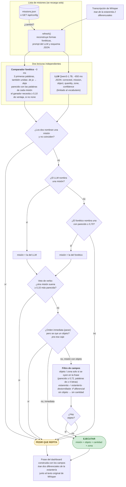

# Decisor de órdenes (`app/interprete.py`, experimental)

| Umbral | Valor | Qué controla |
|---|---|---|
| `PHONETIC_MARGIN` | 0,10 | el ganador fonético debe superar al segundo por esto |
| `STRONG_MATCH` | 0,70 | el fonético decide solo (el LLM dijo none) solo por encima de esto |
| `VETO_MARGIN` | 0,15 | se veta si otra misión suena esto más parecida |
| `FIELD_MATCH` | 0,72 | objeto/zona deben sonar así de parecidos a una palabra de la frase |
